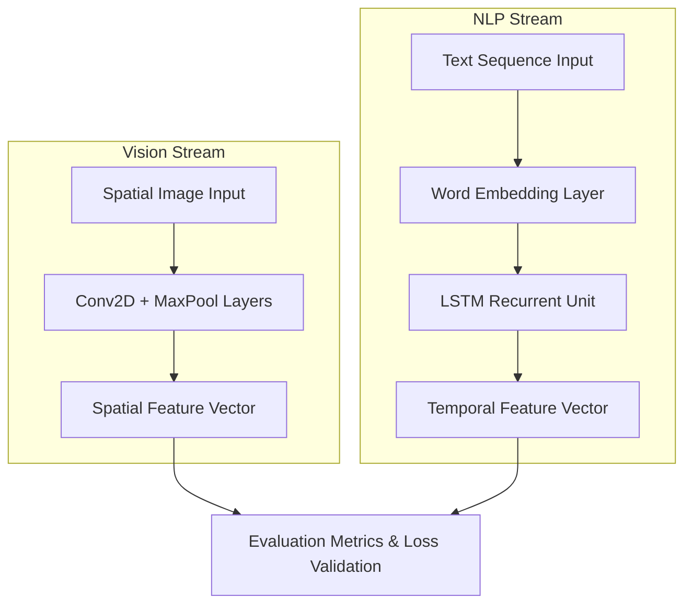

# Hybrid Multi-Modal CNN-LSTM Deep Neural Network

> Dual-stream deep architecture fusing spatial vision features with recurrent sequential text models.

[](https://github.com/sohailahmed-bsrh/hybrid-cnn-lstm-architecture)
[](https://sohail.devsil.com/projects.html)
[](https://sohail.devsil.com)

---

## Overview

Multi-modal tasks require disparate deep learning architectures capable of processing both 2D spatial features and temporal sequences.

This project provides an end-to-end, reproducible implementation engineered to solve this challenge through verified data transformations, reliable algorithms, and production-ready architecture.

---

## Key Features

- Convolutional Neural Network feature extraction stream for spatial pattern classification
- Long Short-Term Memory (LSTM) recurrent network processing sequential semantic data
- End-to-end model checkpointing, loss curve evaluation, and validation metrics
- Modular Jupyter notebook walkthrough with comparative performance analysis

---

## System Architecture



---

## Technology Stack

| Technology | Version / Spec | Role in Architecture |
| :--- | :--- | :--- |
| **TensorFlow / Keras** | `2.12+` | Convolutional and recurrent neural network implementation |
| **OpenCV** | `4.8+` | Image transformation and visual normalization |
| **NumPy & Pandas** | `2.0+` | Tensor manipulations and dataset structuring |

---

## Repository Structure

```text
hybrid-cnn-lstm-architecture/
|-- notebooks/
|   `-- Deep_Learning_Project_using_CNN_(Computer_Vision)_and_LSTM_(NLP).ipynb
|-- data/
|-- .gitignore
|-- requirements.txt
`-- README.md
```

---

## Installation and Execution

### Prerequisites
- Python 3.10 or higher
- Git version control
- Virtual environment manager (`venv`)

### Setup Instructions
1. Clone the repository:
```bash
git clone https://github.com/sohailahmed-bsrh/hybrid-cnn-lstm-architecture.git
cd hybrid-cnn-lstm-architecture
```

2. Configure environment and dependencies:
```bash
python -m venv venv
source venv/bin/activate  # On Windows: venv\Scripts\activate
pip install -r requirements.txt
jupyter notebook notebooks/
```

---

## Interface and Verification
The system produces verifiable execution logs, prediction matrices, or interactive browser interfaces depending on the target mode. Verify operation by executing the commands specified above or inspecting the demonstration notebooks.

---

## Author and Contact
Developed by **Sohail Ahmed** — Full Stack AI Engineer & Machine Learning Specialist.
- **Portfolio:** [sohail.devsil.com](https://sohail.devsil.com)
- **GitHub:** [@sohailahmed-bsrh](https://github.com/sohailahmed-bsrh)
- **Email:** [sohail.bsrh@gmail.com](mailto:sohail.bsrh@gmail.com)

---

## Author & Contact Information

<table width="100%" align="center">
  <tr>
    <td align="center" style="padding: 20px;">
      <h3>Sohail Ahmed</h3>
      <p><strong>Full-Stack Artificial Intelligence & Computer Vision Engineer</strong></p>
      <p>
        <a href="https://sohail.devsil.com"></a>
        <a href="https://github.com/sohailahmed-bsrh"></a>
        <a href="https://linkedin.com/in/sohail-ahmed-dev"></a>
        <a href="mailto:sohail.bsrh@gmail.com"></a>
      </p>
      <p><em>Available for technical roles in Artificial Intelligence, Computer Vision, and Full-Stack Engineering.</em></p>
      <hr style="border: 0; height: 1px; background: #30363d; margin: 15px 0;">
      <small>Distributed under the MIT License.</small>
    </td>
  </tr>
</table>
